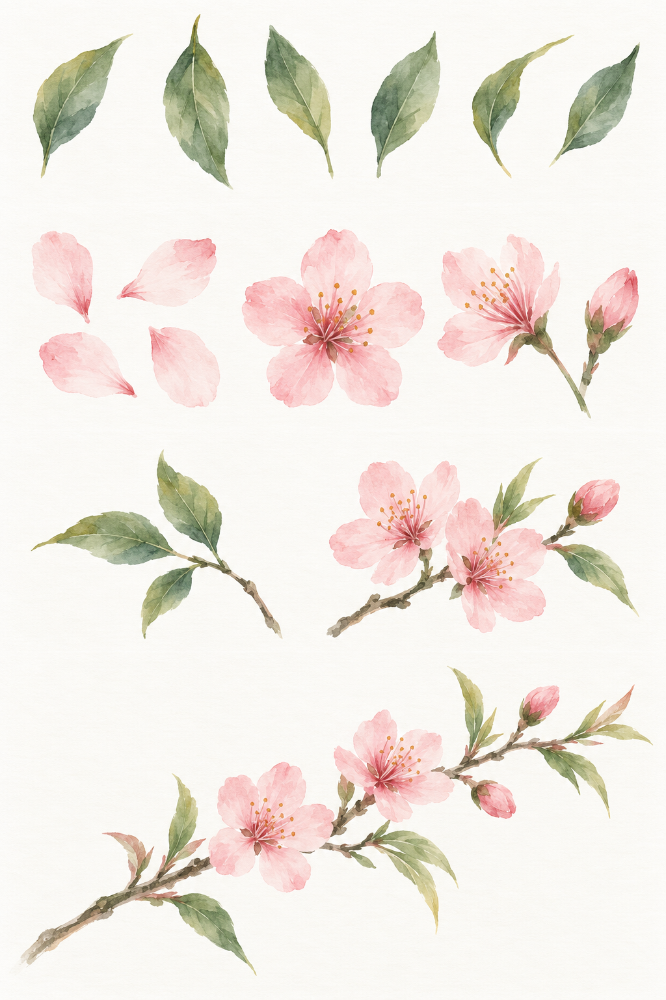

# Procreate 植物没骨画学习计划与临摹素材

整理日期：2026-10-16。适用于初学者，每周练习 3 次，每次 45～60 分钟，共 8 周。某阶段尚不熟练时，可延长一周。

目标：从单叶、花瓣逐步练到花叶组合与折枝小品，学习用色块塑造植物，控制浓淡、边缘与留白。

## 工具与学习方法

没骨画不以墨线勾勒轮廓为主要手段，直接用颜色或墨色表现形体。参考：[故宫博物院「没骨」](https://www.dpm.org.cn/lemmas/242300.html)。

- 画布：建议长边约 3000 像素。
- 笔刷：先准备有压感变化的笔刷、透明水彩类笔刷和细节笔各一支，优先使用已有笔刷。
- 配色：每幅先限制在三至五种主色，并准备深浅变化。
- 图层：可分背景、淡草稿、叶、花和细节，按需要增减。
- 纸纹：先画好形状和颜色，再少量添加。

数字练习侧重植物结构、用笔、透明叠色和边缘处理。以后若转用纸笔，吸水、渗色与干湿时机需要另行练习。

## 8 周练习大纲

| 周次 | 重点 | 具体任务 | 成果与自查 |
| --- | --- | --- | --- |
| 第 1 周 | 笔刷与压感 | 固定一支笔，练轻压、重压、提笔；比较一笔色块与反复叠色 | 一页实验，能有意控制粗细和浓淡 |
| 第 2 周 | 单叶与叶组 | 用“轻落—按下—提起”画叶片，再组合三至五片叶子 | 三组叶子，大小和朝向有变化，连接合理 |
| 第 3 周 | 花瓣与花头 | 练单瓣、正面五瓣花、侧面花和花苞 | 一页花头，花瓣围绕花心组织，有遮挡关系 |
| 第 4 周 | 接色与边缘 | 浅色底上叠深色，局部柔化边缘 | 同一花头画三遍，有层次，花瓣边界清楚 |
| 第 5 周 | 一枝植物 | 固定桃花或海棠等一种题材，连接枝、叶、花、苞 | 两幅一枝花，看得清花叶从哪里长出 |
| 第 6 周 | 局部临摹 | 选恽寿平作品的花叶局部，观察疏密、浓淡和留白 | 一幅局部临摹，记录三条观察 |
| 第 7 周 | 植物写生 | 根据实物或照片画结构草图，再用色块表现，简化次要细节 | 两幅同题练习，植物有辨识度，画面有主次 |
| 第 8 周 | 独立小品 | 画三张构图草图，选一张完成，隔一天再检查 | 一幅完整小品，与第 1 周练习对比 |

### 每次练习的时间分配

1. 观察 5 分钟：花瓣重叠、叶片转向、枝条分叉。
2. 热身 10 分钟：只练当天最重要的动作。
3. 主体 25 分钟：围绕一个问题练，不强求每次完成整幅画。
4. 复盘 10 分钟：保存图片，记录最满意的一处与下次要改的一处。

### 每张素材的三遍练法

1. 画形：用单色抓外形、朝向、遮挡和连接。
2. 画色：加入浓淡与冷暖，先省略细节。
3. 完成局部：补叶脉、花蕊，检查疏密和边缘。

## 生成的入门练习素材



[打开原尺寸练习图](assets/mogu-practice-sheet.png)

这张图使用内置 ImageGen 生成，属于原创练习参考，不是大师原作或古画复制。画面偏透明水彩效果，可用于数字没骨入门；传统笔意以馆藏原作为参照。图中纹理不必逐块照抄，细节也不作为植物学结构标准。

| 区域（从上到下） | 对应阶段 | 练习方法 |
| --- | --- | --- |
| 第一排：单叶 | 第 1～2 周 | 每次选两片，各画三遍；先练外形和浓淡，省略细叶脉 |
| 第二排：花瓣、花头和花苞 | 第 3～4 周 | 从单瓣到整花，最后加花蕊 |
| 第三排：叶组与花枝 | 第 4～5 周 | 练连接和遮挡，观察枝条如何支撑花叶 |
| 第四排：折枝小品 | 第 6 周前后 | 完成一幅小画，比较花朵大小、朝向与留白 |

可把图片保存到 iPad，按区域裁剪副本。参考图与练习画布分开查看，练习时经常缩回整幅大小检查构图。

### 生成记录

- 生成日期：2026-10-16。
- 工具：内置 ImageGen，文字生成，没有上传大师作品作为参考。
- 文件：`assets/mogu-practice-sheet.png`。
- 以下保留实际生成提示词；再次生成不保证得到相同图像。

```text
生成一张供初学者在Procreate中临摹的中国没骨花卉练习参考图，原创教学示例，不是古画复制。Use case: scientific-educational。竖版高清画面，纯净暖白底、极轻微纸纹，无装裱无桌面无工具。用留白分成从上到下四排，每排示例大而清楚。第一排：六片独立的绿色尖椭圆叶，方向不同，色块直接成形，有轻按重按提起的自然笔触，少量叶脉，不勾黑轮廓。第二排：左边四枚分开的浅粉花瓣，中间一朵正面五瓣粉色桃花，右边一朵侧面花和花苞；花瓣半透明，根部略深，少量细花蕊，植物结构清晰可信。第三排：两组小练习，一枝三叶的叶组，一小枝带两朵五瓣粉花和一枚花苞的桃花；连接自然，枝条细而有笔意。第四排：一个清雅简洁的桃花折枝小品，斜向伸展的一段枝条，三朵花、两枚花苞、少量披针形嫩叶，疏密有致，大量留白，适合初学者约一小时临摹。总体用中国传统没骨花卉的透明设色和书写性笔触，有清晰与柔和边缘的变化；禁止厚涂、摄影感、3D、全局模糊、复杂花束、黑色轮廓线。没有文字、数字、题款、印章、水印或名家签名。每排相互分离，可单独裁剪作练习参考。
```

## 大师作品素材目录

先集中临摹恽寿平，便于建立稳定的审美参照。以下均为官方馆藏或发布页面，练习顺序是本计划的建议。仓库保存来源链接，没有收录馆藏图像文件。

| 素材与官方链接 | 建议阶段 | 临摹重点 |
| --- | --- | --- |
| [恽寿平《花卉八帧·双清图》](https://digitalarchive.npm.gov.tw/opendata/Pub/Detail/4695?dep=P&mode=full) | 第 2～3 周，局部练习 | 只取竹叶局部练长叶与疏密，暂略鸟与月景；馆方标注技法为没骨、写意 |
| [恽寿平《花卉册》数字文物页面](https://digicol.dpm.org.cn/cultural/detail?id=abd0f13a7d5644c1b1aae896758d27e5) | 第 4～6 周 | 从页面展示的花卉中选一个花头或一组叶子，每次只临一个局部 |
| [恽寿平《花卉山水图册·其一》官方壁纸](https://www.dpm.org.cn/light/258686.html) | 第 6～8 周 | 保存到 iPad 观看和练配色；壁纸可能裁切，完整构图优先参考馆藏图 |
| [恽寿平《牡丹》册·牡丹（八）](https://digitalarchive.npm.gov.tw/opendata/Pub/DetailEng/4711?dep=P&mode=full) | 第 8 周以后 | 先临一朵花，再临全幅；研究花瓣的深浅和留隙；馆方标注技法为工笔、没骨 |

### 下载与来源记录

台北故宫上述开放图档页面提供 100 万像素（CC0）与 600 万像素（CC BY 4.0）下载。放大临摹优先选 600 万像素，下载可能需要输入验证码。分享中阶原图或裁剪素材时，按页面要求署名，并注明修改。

署名示例：

> 清惲壽平花卉八幀 冊 雙清圖。國立故宮博物院，台北，CC BY 4.0 @ www.npm.gov.tw

若裁剪，另注明“局部裁剪”。北京故宫图片的使用规则以其页面声明为准，不与台北故宫的开放图档授权混用。

延伸阅读：[《恽寿平“没骨花卉”技法之我见》](https://minghuaji.dpm.org.cn/article/detail?id=18951)。

## 常见问题与调整

- 边缘全部模糊：保留花瓣重叠处的清楚边界，只柔化部分边缘。
- 反复涂抹导致笔触消失：先画有方向的形状，再少量调整。
- 颜色混浊：减少同一区域的叠色次数和混色种类。
- 花叶像平铺图案：先检查朝向、遮挡与连接，再增加细节。
- 过度放大和反复撤销：一组练习画完再评估，经常缩回整幅大小。

## 练习记录模板

| 日期 | 周次／素材 | 本次只解决的问题 | 最满意的一处 | 下次调整 | 作品文件 |
| --- | --- | --- | --- | --- | --- |
| 待填写 | 待填写 | 待填写 | 待填写 | 待填写 | 待填写 |

第一课建议：用一种绿色画 12 片叶子，比较压感与叠色变化，选三片加深叶根或一侧，暂时不加纸纹。

## 上传 Git

文档使用相对路径引用图片，将整个 `docs/mogu/` 目录一起提交即可保留图片显示。可在项目根目录执行：

```powershell
git add docs/mogu
git commit -m "添加植物没骨画学习计划与练习素材"
git push
```

推送命令假设当前分支已经配置远端上游。
